<a href="https://princealikhan.com"></a>


### `about.txt`

one exit, one company i shut down myself, still shipping.

- **building**: [deepsmith.ai](https://deepsmith.ai) and [aeonut.com](https://aeonut.com), both about how brands show up in AI search
- **apps**: React Native, plus native iOS and Mac apps
- **product hat**: strategy, PRDs, user research, design systems, go-to-market
- **open source**: [laravel-mautic-api](https://github.com/princealikhan/laravel-mautic-api) · [paytm-payment](https://github.com/princealikhan/paytm-payment) · [devdock](https://github.com/princealikhan/devdock)
- **ask me about**: taking products from 0 → 1

<br clear="right">

### `stack/`


### `work.log`

```console
$ cat work.log
2025–now   deepsmith.ai  co-founder, product  AI search, ex-WarpAI
2023–now   OneJam        co-founder           B2B digital sales rooms
2022–2023  Stackin       solo founder         closed after 14 months
2018–2022  RoundGlass    dev → senior         via zoojoo.BE acquisition
2015–2018  zoojoo.BE     engineer             500k users, acquired
2014–2015  Edumob        co-founder           first startup, e-learning
```